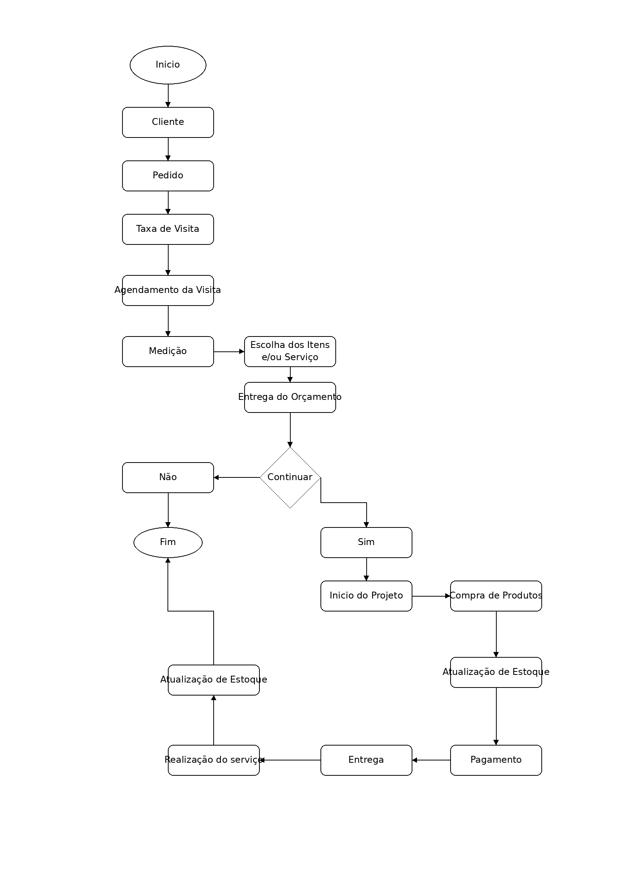
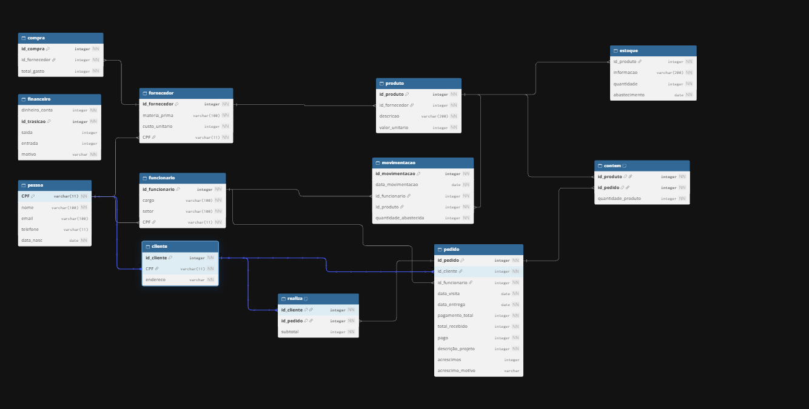

# Projeto ERP — Personal Pisos

## 1. Caracterização da empresa
* **Nome:** Personal Pisos
* **Segmento:** Design de Interiores e Acabamentos.
* **O que vende:** Soluções completas para ambientação, indo desde revestimentos de piso (vinílicos, laminados, porcelanatos) e proteção solar (persianas, cortinas sob medida) até elementos de decoração geral (papel de parede, tapetes, painéis).
* **Principais Clientes:** Pessoas físicas reformando ou construindo a casa própria, arquitetos/designers de interiores parceiros e pequenos construtores.
* **Setores:** Marketing, Vendas, Gerência, Finanças e Contabilidade, RH e Logística/Instalação.
* **Funcionamento Operacional:** Modelo de negócio híbrido (digital e showroom físico).
* **Dados:** Dados do Cliente, Dados Logísticos, Dados Técnicos e Dados Financeiros.

---

## 2. Justificativa da escolha
O grupo escolheu a empresa porque ela já possui um site que precisa de melhorias estruturais e da implementação de um banco de dados organizado para gerenciar suas informações. Além disso, há facilidade de acesso aos processos reais, pois uma das integrantes atua diretamente na empresa.

---

## 3. Identifique os processos de negócio.
Cliente -- Solicita orçamento -- Projeto -- Agendamento de visita -- Medição -- Compra de produtos -- Pagamento -- Entrega --Montagem/Instalação -- Atualização do estoque. 
 
* **Quem participa?**
Cliente, vendedor, designer de interiores, montador e financeiro. 
* **O que inicia o processo?** 
O cliente solicita um orçamento ou procura um produto específico. 
* **O que acontece?** 
É realizado o orçamento, o projeto é definido e, quando necessário, é agendada uma visita para realizar a medição do ambiente. Após a aprovação, ocorre a compra dos produtos, o pagamento, a entrega e a montagem/instalação. 
* **Que informação é gerada?** 
Orçamento, medidas do ambiente, pedido de venda, produtos vendidos, nota fiscal, comprovante de pagamento e atualização do estoque. 
* **Qual é o resultado?** 
O ambiente do cliente é montado/instalado e a venda é concluída. 

---

## 4. Identifique os problemas e necessidades
* **Onde existe retrabalho?**  
Nas obras, quando acontece algum problema em uma instalação ou serviço que não foi considerado a possibilidade durante a visita técnica realizada pré obra; 
Na administração ou venda quando não foram seguidos todos os processos necessários. 
* **Existem informações duplicadas?**
Poucas, mas existem, pois a loja está reestruturando o sistema. 
* **Existem informações perdidas?**
Às vezes, por isso a loja está modernizando o sistema. 
* **A empresa utiliza planilhas?**
Sim, ela utiliza. 
* **Existem controles manuais?**
Poucos, a empresa investiu mais nos sistemas de ERP e planilhas e agora está modernizando o sistema. 
* **Os setores compartilham informações?**
Sim, compartilham. 
* **É difícil encontrar informações?**
De acordo com as informações passadas pelo dono não é. 
* **Existem erros de cadastro?**
Raramente. 
* **É difícil acompanhar estoque, vendas, clientes ou funcionários?**
Não, desde que esteja tudo devidamente cadastrado. Porém hoje o estoque é algo que dá um pouco mais de trabalho pois a empresa não possui um colaborador específico para organizar/catalogar. 
* **Existem problemas para gerar relatórios?**
Não. 
* **PROBLEMAS E NECESSIDADES**
* **Problema**: Problemas não identificados durante a visita técnica pré-obra. 
* **Consequência**: Retrabalho durante a instalação ou execução do serviço; 

* **Problema**: Processos de administração ou venda não seguidos corretamente. 
* **Consequência**: Retrabalho e possíveis atrasos nos processos; 

* **Problema**: Informações duplicadas durante a reestruturação do sistema. 
* **Consequência**: Necessidade de reorganização e conferência dos dados; 

* **Problema**: Possibilidade de perda de informações. 
* **Consequência:** Dificuldade para manter todos os dados organizados e disponíveis; 

* **Problema**: Uso de planilhas junto aos sistemas. 
* **Consequência**: Necessidade de modernização e integração dos controles; 

* **Problema**: Controle de estoque sem colaborador específico. 
* **Consequência**: Maior dificuldade e trabalho para acompanhar o estoque; 

* **Problema**: Informações dependentes de cadastro correto. 
* **Consequência**: Possibilidade de dificuldades no acompanhamento quando há falhas no cadastro.

---

## 5. Requisitos funcionais

* **RF1** - Cadastro com os dados pessoais do cliente, como e-mail pessoal, número de celular, nome completo, CPF ou CNPJ, data de nascimento e CEP, juntamente com a verificação em dois fatores durante a autenticação.

* **RF2** - Todo projeto realizado deve ter a emissão de um relatório contendo informações desde o planejamento até a instalação, incluindo materiais utilizados, custos e etapas concluídas.

* **RF3** - O sistema deve disponibilizar um canal de contato entre cliente e atendente para dúvidas e solicitações de alterações referentes ao projeto, mantendo o histórico das conversas.

* **RF4** - O sistema deve permitir o controle da entrada e saída de produtos do estoque, registrando as quantidades movimentadas e os respectivos valores financeiros.

* **RF5** - O sistema deve permitir que o atendente crie orçamentos prévios de serviços para os clientes, informando o período previsto de execução, os itens desejados, os valores e um prazo de validade configurável (ex.: 7 dias).

* **RF6** - O sistema deve registrar o estilo de decoração desejado pelo cliente, incluindo preferências de cores, materiais e acabamentos, para auxiliar na elaboração do projeto e do orçamento.

* **RF7** - O sistema deve registrar todas as etapas do processo, desde a compra dos materiais com os fornecedores até a instalação dos produtos no ambiente do cliente.

* **RF8** - O sistema deve permitir o cadastro e a atualização da disponibilidade comercial dos produtos, indicando quais podem ou não ser vendidos, independentemente da quantidade física disponível em estoque.

* **RF9** - Toda alteração no status de um projeto deve ser registrada no sistema, incluindo a data da alteração, o status e o usuário responsável, utilizando estados previamente definidos, como em planejamento, em execução, aguardando aprovação ou concluído.

* **RF10** - A aprovação de um projeto pelo cliente deve ser registrada com a data da aprovação, a identificação do cliente responsável e a versão do projeto aprovada.

* **RF11** - O sistema deve permitir o cadastro de fornecedores, armazenando informações como nome, CPF ou CNPJ, telefone, endereço e materiais fornecidos.

* **RF12** - O sistema deve permitir o registro e o acompanhamento dos pagamentos relacionados aos projetos, incluindo valores pagos, valores pendentes, datas de pagamento e situação financeira de cada pedido.

* **RF13** - O sistema deve permitir o agendamento de medições, visitas técnicas e instalações, registrando data, horário, endereço, profissional responsável e projeto relacionado.

* **RF14** - O sistema deve permitir o cadastro e a atualização de produtos e materiais, armazenando informações como código identificador, descrição, categoria, unidade de medida, preço e fornecedor relacionado, quando aplicável.

## 6. Requisitos não funcionais

* **RNF1** – O sistema deve fazer backup dos dados todos os dias à 00:00 (meia noite) ou sempre que houver uma atualização. 

* **RNF2** - O sistema deve funcionar 24/7 (24 horas por dia durante 7 dias por semana). 

* **RNF3** - O sistema deve exigir autenticação por login e senha para permitir o acesso às funcionalidades restritas. 

* **RNF4** - O sistema deve controlar o acesso às informações de acordo com o perfil do usuário, como administrador, designer de interiores e funcionário. 

* **RNF5** - Os dados pessoais dos clientes devem ser protegidos de acordo com a Lei Geral de Proteção de Dados (LGPD). 

* **RNF6** - O sistema deve utilizar um banco de dados relacional para garantir a organização e a integridade das informações cadastradas. 

* **RNF7** - O sistema deve validar os dados inseridos nos formulários, impedindo o cadastro de informações em formatos inválidos. 

* **RNF8** - Os valores monetários devem ser armazenados e processados com precisão decimal, evitando erros de arredondamento nos cálculos financeiros. 

* **RNF9** - O sistema deve manter um padrão de nomenclatura para tabelas, campos e relacionamentos do banco de dados, facilitando sua manutenção. 

* **RNF10** - O código-fonte do sistema deve ser organizado e documentado para facilitar futuras correções e atualizações. 

* **RNF11** - O sistema deve registrar logs de erros e falhas técnicas para facilitar a identificação e a correção de problemas. 

* **RNF12** - O sistema deve permitir a manutenção e a atualização de seus componentes sem comprometer a integridade dos dados armazenados.
  
---
 
## 7. Regras de negócio

* **RN1:** Um mesmo item não pode ser vendido para mais de um cliente.
* **RN2:** Um sinal de 35% do valor total da compra deve ser pago à vista, e o restante pode ser parcelado em até 10x sem juros.
* **RN3:** Calcular o valor total do pedido levando em consideração o material escolhido, a compra com o fornecedor para preenchimento do estoque, a quantidade de material que será usado (com base na medida feita) e a instalação.
* **RN4:** Cancelamento em até 7 dias após o pagamento do sinal, caso contrário o valor pago não é devolvido e o cliente escolhe outro produto ou material se desejar.
* **RN5:** Todo cliente deve possuir um cadastro único no sistema, contendo nome completo, CPF ou CNPJ, telefone, e-mail e endereço.
* **RN6:** Cada projeto de design de interiores deve estar vinculado a um único cliente responsável pela contratação do serviço.
* **RN7:**  Um cliente pode contratar vários projetos de design de interiores, mas cada projeto deve possuir um identificador único.
* **RN8:** Todo projeto deve possuir uma data de início prevista e uma data de entrega prevista.
* **RN9:** Cada ambiente deve possuir medidas registradas antes da definição dos materiais e móveis que serão utilizados no projeto.
* **RN10:** Todo material cadastrado no banco de dados deve possuir código único, descrição e preço de custo.
* **RN11:** A quantidade de materiais disponível em estoque deve ser atualizada sempre que houver entrada por compra ou saída para uso em um projeto.
* **RN12:** Toda compra de materiais realizada pela empresa deve estar vinculada a um fornecedor já cadastrado no sistema.
* **RN13:** Cada pedido de compra de materiais deve registrar a data da compra, os materiais adquiridos, suas quantidades e os respectivos valores unitários.
* **RN14:** Todo serviço de instalação contratado deve estar vinculado a um projeto específico e possuir descrição, valor e prazo previsto para execução.
* **RN15:** Cada funcionário ou profissional responsável por um projeto deve estar cadastrado no sistema e possuir uma função definida.
* **RN16:** Um projeto pode ter vários profissionais responsáveis por diferentes atividades, mas cada atividade deve possuir um responsável definido.
* **RN17:** Toda alteração no status de um projeto deve ser registrada no sistema, utilizando estados previamente definidos, como em planejamento, em execução, aguardando aprovação ou concluído.
* **RN18:** A aprovação de um projeto pelo cliente deve ser registrada com a data da aprovação e a identificação do projeto correspondente.
* **RN19:** Um mesmo item não pode estar em outro estoque ao mesmo tempo.

---

## 8. Identifique as restrições e políticas organizacionais
* **Quem pode aprovar uma operação?**
Apenas os Gerentes/Dono podem realizar operações. 

* **Quem pode alterar determinado cadastro?**
Todos os cadastros podem ser editados pelos clientes, porém somente o gerente pode excluir as informações. 

* **Limites de desconto?**
Toda compra possui um limite de 5 a 10% de desconto baseado no valor total da compra. 

* **Condições de pagamento?**
É possível pagar à vista ou parcelado (sendo no parcelado necessário um sinal de 35% e o restante pode ser feito em até 10x sem juros). 

* **Regras de cancelamento**
As regras de cancelamento seguem o Código de Defesa do Consumidor, sendo 7 dias para devolução total do valor gasto, caso já tenha havido algum valor gasto com compra de material, isso será negociado diretamente com o cliente. 

* **Políticas de estoque**
O estoque é conferido uma vez por mês e é abastecido conforme a realização das vendas, pois a loja não trabalha com estoque de todos os produtos. 

* **Regras de acesso às informações**
A loja segue a LGPD - Lei Geral de Proteção de Dados, ou seja, ela informa onde serão utilizados os dados dos clientes, coleta apenas as informações necessárias e possui medidas de segurança contra o vazamento de dados. 

* **Existe alguma decisão da empresa que precisa ser respeitada pelo sistema?**
Sim, algumas coisas são permitidas apenas com autorização do gerente. Como: 
**Desconto maior que 5%;**
**Exclusão de dados do sistema;**
**Outros métodos de pagamento, como boleto.**

---

## 9. Fluxograma dos principais processos

---

## 10. Dicionário de dados conceitual

| Entidade | Atributo | Descrição | Regra / Observação |
| :--- | :--- | :--- | :--- |
| **Pessoa** | `CPF` | Identificador único da pessoa | **PK** - Obrigatório e único |
| **Pessoa** | `Nome` | Nome completo | Obrigatório |
| **Pessoa** | `Email` | Correio eletrônico | Formato de e-mail válido |
| **Pessoa** | `Telefone` | Telefone de contato | Obrigatório |
| **Pessoa** | `Data_Nascimento` | Data de nascimento | Formato Data |
| **Cliente** | `ID_Cliente` | Identificador do cliente | **PK** - Auto incremento |
| **Cliente** | `Endereço` | Endereço completo para entrega | Obrigatório |
| **Cliente** | `CPF` | CPF da pessoa associada | **FK** referenciando `Pessoa(CPF)` |
| **Funcionário** | `ID_Funcionário` | Identificador do funcionário | **PK** |
| **Funcionário** | `Cargo` | Função na empresa | Ex: Vendedor, Gerente |
| **Funcionário** | `Setor` | Setor de atuação | Ex: Vendas, Logística |
| **Funcionário** | `CPF` | CPF da pessoa associada | **FK** referenciando `Pessoa(CPF)` |
| **Fornecedor** | `ID_Fornecedor` | Identificador do fornecedor | **PK** |
| **Fornecedor** | `Matéria-Prima` | Descrição do insumo | Texto |
| **Fornecedor** | `Custo_Unitario` | Custo de aquisição do item | Valor monetário |
| **Fornecedor** | `CPF` | Documento do responsável/empresa | **FK** referenciando `Pessoa(CPF)` |
| **Compra** | `ID_Compra` | Registro da ordem de compra | **PK** |
| **Compra** | `ID_Fornecedor` | Código do fornecedor | **FK** referenciando `Fornecedor` |
| **Compra** | `Total_Gasto` | Valor gasto na compra | Valor monetário |
| **Produto** | `ID_Produto` | Código identificador do produto | **PK** |
| **Produto** | `Descrição` | Especificação técnica e nome | Texto |
| **Produto** | `Valor_Unitario` | Preço de venda ao consumidor | Valor monetário |
| **Produto** | `ID_Fornecedor` | Código do fornecedor | **FK** referenciando `Fornecedor` |
| **Estoque** | `ID_Produto` | Código do produto em estoque | **FK** referenciando `Produto` |
| **Estoque** | `Informação` | Detalhes do lote e armazenamento | Texto |
| **Estoque** | `Quantidade` | Unidades/m² em estoque | Numérico inteiro/decimal |
| **Estoque** | `Abastecimento` | Frequência de reposição | Semanal ou Mensal |
| **Pedido** | `ID_Pedido` | Identificador único do pedido | **PK** |
| **Pedido** | `ID_Cliente` | Código do cliente | **FK** referenciando `Cliente` |
| **Pedido** | `ID_Funcionário` | Identificador do funcionário | **FK** referenciando `Produto` |
| **Pedido** | `Data_Entrega` | Data prevista de entrega | Formato Data |
| **Pedido** | `Data_Visita` | Data prevista de instalação | Formato Data |
| **Pedido** | `Total_Recebido` | Valor final do pedido | Valor monetário |
| **Pedido** | `Pago` | quantia paga | valor monetário |
| **Pedido** | `Descrição_Projeto` | descrição do projeto | inteiro obrigatório |
| **Pedido** | `Acréscimos` | Custos extras (frete/mão de obra) | Valor monetário |
| **Pedido** | `Acréscimo_Motivo` | motivação | caractere |
| **Realiza** | `ID_Cliente` | Código do cliente | **FK** referenciando `Cliente` |
| **Realiza** | `Código_Pedido` | Código do pedido | **FK** referenciando `Pedido` |
| **Realiza** | `Subtotal` | Valor acumulado do cliente no pedido | Atributo próprio do relacionamento |
| **Contém** | `Código_Pedido` | Código do pedido | **FK** referenciando `Pedido` |
| **Contém** | `Código_Produto` | Código do produto | **FK** referenciando `Produto` |
| **Contém** | `Quantidade_De_Produtos` | Quantidade comprada do produto | Numérico |
| **Movimentação** | `ID_Movimentação` | Identificador único da movimentação | **PK** |
| **Movimentação** | `ID_Funcionário` | Identificador do funcionário | **FK** referenciando `Produto` |
| **Movimentação** | `ID_Produto` | Código do produto em estoque | **FK** referenciando `Produto` |
| **Movimentação** | `Data_Movimentação` | data da movimentação | data | 
| **Movimentação** | `Quantidade_Abastecida` | quantidade abastecida | inteiro obrigatório |
| **Financeiro** | `ID_Transição` | Identificador único das transações | **PK** |
| **Financeiro** | `Dinheiro_Conta` | quantidade monetária em conta | inteiro e obrigatório |
| **Financeiro** | `Saída` | identificador das saídas | inteiro |
| **Financeiro** | `Entrada` | Identificador das entradas | inteiro |
| **Financeiro** | `Motivo` | motivação das transações | caractere obrigatório |

---

## 11. Entidades
`Pessoa` – `Cliente` – `Funcionário` – `Fornecedor` – `Compra` – `Produto` – `Estoque` – `Pedido` – `Realiza` – `Contém`- `Financeiro`- `Movimentação`

---

## 12. Atributos
* **Pessoa:** `Nome` – `Email` – `Telefone` – `Data_Nascimento` – `CPF (PK)`
* **Cliente:** `ID_Cliente (PK)` – `Endereço` – `CPF (FK)`
* **Funcionário:** `ID_Funcionário (PK)` – `Cargo` – `Salario` – `CPF (FK)` – `Setor`
* **Fornecedor:** `Código_Fornecedor (PK)` – `Matéria-Prima` – `Custo_Unitario` – `CPF (FK)`
* **Compra:** `ID_Compra (PK)` – `Código_Fornecedor (FK)` – `Total_Gasto`
* **Produto:** `Código_Produto (PK)` – `Descrição` – `Valor_Unitario`
* **Estoque:** `Código_Produto (PK/FK)` – `Informação` – `Quantidade_De_Cada_Produto` – `Abastecimento`
* **Contém:** `Código_Pedido (FK)` – `Código_Produto (FK)` – `Quantidade_De_Produtos`
* **Pedido:** `Código_Pedido (PK)` – `Data_De_Entrega` – `Pagamento_Total` – `Acréscimos`
* **Realiza:** `ID_Cliente (FK)` – `Código_Pedido (FK)` – `Subtotal`
* **Financeiro** `Motivo` - `Entrada` - `Saída` - `Dinheiro_conta` - `ID_transação (PK)`
* **Movimentação** `Quantidade_Abastecida` - `Data_Movimento` - `ID_Produto (FK)` - `ID_Funcionario (FK)` - `ID_Movimentação (PK)`

---

## 13. Relacionamentos

* **Pessoa – Cliente**
  * **Entidades Relacionadas:** Pessoa e Cliente
  * **Tipo de Relacionamento:** Especialização/Herança
  * **Descrição:** A entidade Cliente deriva da entidade genérica Pessoa
  * **Atributo de Ligação:** `CPF` (Chave Primária em Pessoa e Chave Estrangeira em Cliente)

* **Pessoa – Funcionário**
  * **Entidades Relacionadas:** Pessoa e Funcionário
  * **Tipo de Relacionamento:** Especialização/Herança
  * **Descrição:** A entidade Funcionário deriva da entidade genérica Pessoa
  * **Atributo de Ligação:** `CPF` (Chave Primária em Pessoa e Chave Estrangeira em Funcionário)

* **Pessoa – Fornecedor**
  * **Entidades Relacionadas:** Pessoa e Fornecedor
  * **Tipo de Relacionamento:** Associação/Especialização
  * **Descrição:** Vincula o cadastro de Fornecedor á pessoa física responsável 
  * **Atributo de Ligação:** `CPF` (Chave Primária em Pessoa e Chave Estrangeira em Fornecedor)

* **Cliente – Pedidos (via Tabela/Relacionamento "Realiza")**
  * **Entidades Relacionadas:** Cliente e Pedido (ligadas através da entidade associativa Realiza)
  * **Tipo de Relacionamento:** Entidade Associativa
  * **Descrição:** Registra quais pedidos foram realizados por determinado cliente, Contendo o subtotal.
  * **Atributos de Ligação:** `ID_Cliente (FK)` e `Código_Pedido (FK)`

* **Pedido – Produto (via Tabela/Realacionamento "Contém")**
  * **Entidades Relacionadas:** Pedido e Produto (ligadas através da entidade associativa Contém)
  * **Tipo de Relacionamento:** Entidade Associativa
  * **Descrição:** Associa os produtos que fazem parte de cada pedido e a respectiva quantidade de itens.
  * **Atributos de Ligação:** `Código_Pedido (FK)` e `Código_Produto (FK)`

* **Fornecedor – Compra**
  * **Entidades Relacionadas:** Fornecedor e Compra
  * **Tipo de Relacionamento:** 1:N Entidade Forte/Entidade Fraca
  * **Descrição:** Registra as compras efetuadas junto a um fornecedor e o total gasto.
  * **Atributo de Ligação:** `Id_fornecedor` (PK em Fornecedor e FK em Compra)

* **Compra – Produto**
  * **Entidades Relacionadas:** Compra e Produto
  * **Tipo de Relacionamento:** Entidades Fortes/Entidade Fraca
  * **Descrição:** Associa as aquisições/compras efetuadas aos produtos do catálogo.
  * **Atributo de Ligação:** `Id_produto` / Associação entre as entradas de compra e o produto.
* **Produto – Estoque**
  * **Entidades Relacionadas:** Produto e Estoque
  * **Tipo de Relacionamento:** Relacionamento entre duas Entidades Fortes
  * **Descrição:** Associa as informações físicas de estoque e periodicidade de abastecimento ao produto correspondente.
  * **Atributo de Ligação:** `Id_produto` (PK em Estoque e FK/Referência em Produto)

---

## 14. Cardinalidades

* **Pessoa -> Cliente / Funcionário / Fornecedor:** `(0,1)` para `(1,1)`. Uma pessoa pode ser cadastrada como cliente, funcionário ou fornecedor.
* **Cliente -> Pedido ("Realiza"):** `(0,N)` para `(1,1)`. Um cliente pode realizar zero ou vários pedidos, mas um pedido pertence a um único cliente.
* **Pedido -> Produto ("Contém"):** `(1,N)` para `(0,N)`. Um pedido contém pelo menos 1 produto e um produto pode estar contido em vários pedidos (Relacionamento N:M).
* **Fornecedor -> Compra:** `(0,N)` para `(1,1)`. Um fornecedor pode estar em várias compras, e cada compra está associada a 1 fornecedor.
* **Produto -> Estoque:** `(1,1)` para `(1,1)`. Cada produto cadastrado possui exatamente 1 registro de controle de estoque correspondente.

---

## 15. Diagrama Entidade-Relacionamento (DER)

---

## 16 – Justificativas técnicas das principais decisões de modelagem

### 1. Pessoa como entidade central de cadastro, com Cliente, Funcionário e Fornecedor como especializações
Observou que Cliente, Funcionário e Fornecedor possuem em comum os mesmos dados pessoais: `CPF`, `Nome`, `Email`, `Telefone` e `Data_Nascimento`. Por conta disso, optou por concentrar essas informações em uma única entidade, denominada **Pessoa**, de modo que cada papel passasse a armazenar somente os atributos que são próprios, como `Cargo` e `Salário`, no caso do Funcionário. O vínculo entre as entidades é estabelecido por meio do `CPF`, que atua como chave primária (`PK`) em **Pessoa** e como chave estrangeira (`FK`) nas outras. Essa solução evita a repetição de dados pessoais e permite que um mesmo indivíduo desempenhe mais de um papel no sistema sem a necessidade de ser cadastrado novamente.

### 2. Entidades associativas Contém e Realiza
Um pedido pode conter diversos produtos e, por outro lado, um mesmo produto pode figurar em vários pedidos, caracterizando um relacionamento muitos para muitos. Para resolver essa situação, criou a entidade associativa **Contém**, responsável por registrar a `Quantidade_De_Produtos` referente a cada item do pedido. Já a entidade **Realiza** estabelece a ligação entre o Cliente e o Pedido, armazenando o `Subtotal` da compra. Dessa forma, as informações da venda são devidamente registradas sem que haja duplicação de dados nas tabelas Pedido e Produto.

### 3. Separação entre Produto e Estoque
A entidade **Produto** reúne os dados estáveis do catálogo, isto é, `Descrição` e `Valor_Unitario`, ao passo que a entidade **Estoque** concentra as informações sujeitas a alterações frequentes, a saber, `Informação`, `Quantidade_De_Cada_Produto` e `Abastecimento`. Esta separação está alinhada à rotina da empresa, que realiza a conferência do estoque mensalmente e o reabastece de acordo com o volume de vendas. Assim, o saldo pode ser atualizado sem que seja necessário alterar o cadastro do produto. O relacionamento entre as duas entidades é do tipo 1 para 1, uma vez que cada produto possui exatamente um registro de estoque.

### 4. Código_Produto como chave primária de Produto
O `Código_Produto` foi definido como chave primária (`PK`) por identificar cada produto de maneira única, permitindo que as demais entidades façam referência a ele sem ambiguidade. Esse atributo é utilizado como chave estrangeira (`FK`) na entidade **Contém** e como chave primária e estrangeira (`PK/FK`) na entidade **Estoque**, o que assegura que somente existam itens de pedido e registros de estoque associados a produtos previamente cadastrados.

---

## 18. Conclusão
Esta entrega estabelece o Modelo Conceitual formal para a Personal Pisos, estruturando os requisitos coletados em entidades, atributos, relacionamentos e regras de negócio. O modelo atende às necessidades operacionais e de gestão da empresa e serve como base sólida para a próxima fase do projeto (Modelo Lógico, Normalização e DDL em Banco de Dados Relacional).
